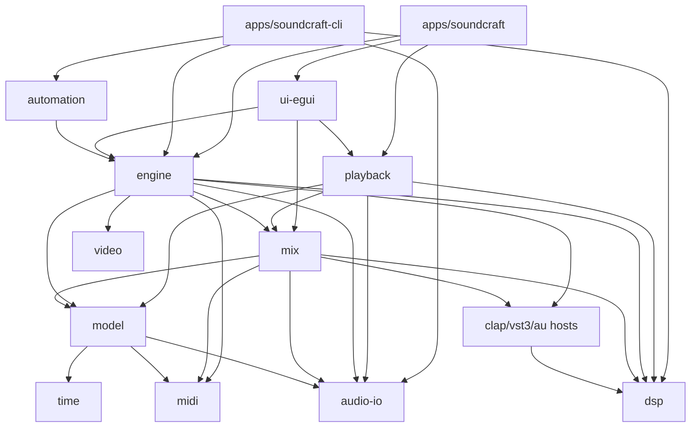

# Code map (our fork)

The code is upstream's Cargo workspace (`Cargo.toml` members). Upstream's own design notes are in `docs/` (start with `docs/control-protocol.md`, `docs/hardware-parity.md`, `docs/plugin-parity.md`). This map is ours: what each module owns, how they connect, and what differs per platform (R04). The quality gate for every module is `cargo xtask ci`.

## Modules

| Path | Crate | Owns | Platform notes |
|---|---|---|---|
| `crates/time` | soundcraft-time | Timebases: samples, Bars\|Beats, Min:Secs, Timecode, Feet+Frames, tempo and meter maps, grid | pure, all |
| `crates/audio-io` | soundcraft-audio-io | Audio file I/O: WAV/BWF/RF64, AIFF/AIFF-C, FLAC encoder, symphonia decoders; the disk-backed `SampleSource` (ours) | pure, all |
| `crates/midi` | soundcraft-midi | Note/controller sequences, SMF import/export, MIDI editing, GM names. No device I/O yet (G-02) | pure, all; device layer will be per OS (CoreMIDI, WinMM, ALSA) |
| `crates/model` | soundcraft-model | The session document: tracks, playlists, clips, mixer, routing, automation, markers (`.scraft`) | pure, all |
| `crates/dsp` | soundcraft-dsp | Built-in realtime plugins, meters, loudness, offline processing; the safe plugin trait the hosts implement | pure, all; SIMD paths must dispatch at runtime |
| `crates/clap-host` | soundcraft-clap-host | Third-party CLAP hosting behind the dsp plugin trait | all; editors embedded on Windows and macOS |
| `crates/vst3-host` | soundcraft-vst3-host | Third-party VST3 hosting | all; editors on macOS and Windows, not Linux (upstream PR #1127 adds X11) |
| `crates/au-host` | soundcraft-au-host | Audio Unit (AUv2) hosting | **macOS only**; no editor views yet (upstream PR #1050) |
| `crates/video` | soundcraft-video | MP4/MOV demux, H.264/ProRes/MJPEG decode, thumbnails | pure, all |
| `crates/mix` | soundcraft-mix | Renders a session (tracks, plugins, sends, busses, automation) to audio, offline and realtime | all |
| `crates/engine` | soundcraft-engine | Command engine: commands, undo, editing, import/export, bounce, parity catalog | all |
| `crates/playback` | soundcraft-playback | Realtime device I/O through cpal: playback, recording, input monitoring | per OS: CoreAudio, WASAPI (ASIO behind the opt-in `asio` feature), ALSA/PulseAudio; no JACK yet (#24) |
| `crates/automation` | soundcraft-automation | Agent control: MCP server (stdio JSON-RPC), headless backend, control channel | all |
| `crates/ui-egui` | soundcraft-ui-egui | Edit and Mix windows, transport, dialogs, docking, control channel | all; macOS system menu bar, Windows DX12 default, Linux fontconfig |
| `apps/soundcraft` | soundcraft | Desktop app binary | all; packaging in `packaging/` (DMG, MSI, Flatpak, AppImage) |
| `apps/soundcraft-cli` | soundcraft-cli | Headless editing, convert, bounce, MCP server | all |
| `apps/soundcraft-web` | soundcraft-web | Browser build (WebGPU/WebGL2, WebAudio) | wasm |
| `xtask` | xtask | `cargo xtask ci`, parity report, packaging helpers | all |

## How they connect

Upstream's layer rule (checked by `cargo xtask ci`): lower crates never depend on higher ones; nothing depends on `ui-egui`.

## Mac, PC and Linux

- CI: `pr-ci.yml` (ours) runs `cargo xtask ci` on Linux and `cargo test --workspace` on macOS and Windows for every PR; upstream's `ci.yml`, `freebsd.yml`, `windows-arm64.yml` run on push.
- Platform-specific code is behind `cfg(target_os)`: au-host (macOS), plugin editor windows (HWND, NSView, X11), audio backends (playback), menu bar (macOS). A change there needs the `platform:*` label.
- Paths: plugin search paths and preferences folders differ per OS; tests never load installed plugins.
- Runtime smoke tests (launch, draw a frame, play through the silent clock) don't exist yet on any OS (G-14).
